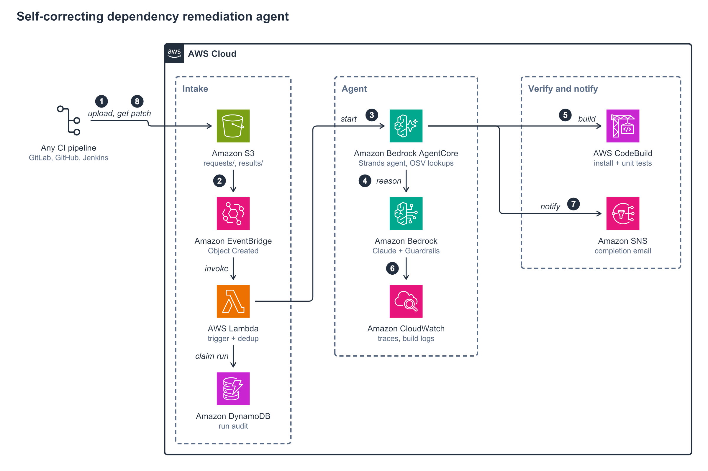

# Self-correcting dependency remediation agent

An AI agent that fixes vulnerable open-source dependencies in Python, Node.js, and Java projects, built with
[Strands Agents](https://strandsagents.com) and hosted on Amazon Bedrock AgentCore.

Upload a repository archive to Amazon S3 and the agent finds vulnerable dependencies, upgrades them to the
lowest safe versions, runs the build and unit tests in AWS CodeBuild, repairs code that the upgrade broke, and
returns a **verified patch** plus a report. Your pipeline applies the patch and opens the merge request or pull
request, so the solution works with any Git host or CI system (GitLab, GitHub, Bitbucket, Jenkins, AWS CodePipeline).
The agent holds no source-control credentials and cannot push code.

> **Sample code.** This project is sample code for an AWS Prescriptive Guidance pattern. Review
> [SECURITY.md](SECURITY.md) and apply the production hardening recommendations before using it with production workloads.



## Table of contents

- [How it works](#how-it-works)
- [Agent tools and guards](#agent-tools-and-guards)
- [Result statuses](#result-statuses)
- [Repository layout](#repository-layout)
- [Prerequisites](#prerequisites)
- [Deploy](#deploy) (including [Choosing a Region](#choosing-a-region))
- [Use it](#use-it)
- [Test](#test)
- [Configuration](#configuration)
- [Troubleshooting](#troubleshooting)
- [Cost](#cost)
- [Security](#security)
- [Extending](#extending)
- [Clean up](#clean-up)
- [Contributing](#contributing)
- [License](#license)

## How it works

1. A CI job (or a developer) runs `remediate`. It zips the working tree and uploads it to
   `s3://<bucket>/requests/<project>/<run-id>/source.zip`.
2. S3 sends an Object Created event to Amazon EventBridge, which invokes the trigger function.
3. The trigger claims the run ID in Amazon DynamoDB (redelivered events never start a second run) and invokes
   the agent on AgentCore Runtime.
4. The agent scans the declared dependencies against OSV, upgrades the vulnerable ones, builds and tests in
   CodeBuild, reads failures, fixes the code, and retries within a budget.
5. The agent writes `result.json`, `fix.patch`, and `report.md` to `s3://<bucket>/results/<project>/<run-id>/`
   and the run record to DynamoDB. It publishes a plain-text summary to an Amazon SNS topic (email subscribers
   receive it) and a "Remediation Completed" event on the default EventBridge bus for other integrations.
6. `remediate` downloads the results. The CI job runs `git apply --index fix.patch` and opens the review.

## Agent tools and guards

| Step | Tool | Guard enforced by code |
|---|---|---|
| Find vulnerabilities | `scan_dependencies` | OSV lookup for every directly declared, exactly pinned dependency |
| Reuse past fixes | `recall_similar_fixes` | AgentCore Memory; failures never fail a run |
| Pick a version | `choose_target_version` | Lowest stable version with no OSV advisories |
| Upgrade | `update_dependency_version` | Rejects versions that are older, unpublished, or still vulnerable |
| Explore and edit | `list_files`, `read_file`, `search_code`, `replace_in_file`, `write_file`, `revert_file` | Stays inside the repo; blocks CI/CD files; change budget; size limit |
| Give up on one package | `skip_package` | Only after its manifest change is reverted |
| Verify | `run_build_and_tests` | Runs in CodeBuild, not in the agent; attempt budget |
| Deliver | `submit_fix` | Only if the latest build passed and nothing changed since |
| Stop | `stop_remediation` | Always allowed; recorded |

A Strands hook caps the total number of tool calls. The final status comes from tool state, never from the model's text.

## Result statuses

| Status | Meaning | `remediate` exit code |
|---|---|---|
| `FIXED` | Every vulnerable dependency upgraded; build passed; `fix.patch` produced | 0 |
| `PARTIAL_FIX` | Some upgraded (patch produced), others listed as not fixed in the report | 0 |
| `NO_VULNERABILITIES` | Nothing to do | 0 |
| `NOT_FIXED`, `BUDGET_EXHAUSTED`, `INCOMPLETE` | No verified fix; the report includes the last build log | 2 |
| `ERROR` | The run failed | 1 |

## Repository layout

```
agent/remediation_agent/   Agent container for AgentCore Runtime (arm64)
  main.py                  Entrypoint: validates the request key, runs in the background
  runner.py                One run: load archive, run the agent, publish results
  tools.py                 Strands tools and guards
  prompts.py               System prompt
  ecosystems/              Python (requirements.txt), Node.js (npm), Java (Maven) adapters
  advisories.py            OSV lookups and safe-version selection
  build_runner.py          CodeBuild and local build backends
  results.py, report.py    result.json, fix.patch, report.md, completion email and event
  workspace.py             Sandboxed working copy and patch generation
functions/trigger/         Lambda: S3 upload event -> agent invocation
infra/                     AWS CDK stack
  remediation_stack.py     All resources and IAM policies
  settings.py              Reads .env; picks the model inference profile for the Region
app.py, cdk.json           CDK app entry point and agent budgets
.env.example               Deployment settings template (copy to .env)
client/                    remediate CLI (pip installable, needs only boto3)
ci-templates/              GitLab CI, GitHub Actions, and a generic shell script
tests/                     Unit, security, and infrastructure tests
diagrams/                  Architecture diagram
.ash/.ash.yaml             Security scan (ASH) configuration and reviewed suppressions
docs/security/             Latest ASH scan reports
SECURITY.md                Threat model, controls, known considerations, hardening
CONTRIBUTING.md            How to contribute and develop locally
CODE_OF_CONDUCT.md, LICENSE
```

## Prerequisites

- An AWS account in a Region where Amazon Bedrock AgentCore is available, with model access to the model you deploy with (see [Choosing a Region](#choosing-a-region))
- AWS CLI v2, AWS CDK v2 (bootstrapped), Python 3.12+, [uv](https://docs.astral.sh/uv/), and Docker, Finch, or Podman
  (for Finch or Podman, set `CDK_DOCKER=finch` or `CDK_DOCKER=podman`; the agent image and trigger function are
  built for arm64, so x86 hosts need QEMU emulation)
- Projects with automated unit tests (the agent relies on tests to confirm a fix)

## Deploy

```bash
cp .env.example .env                   # then set AWS_REGION (and optionally NOTIFICATION_EMAIL)
uv sync
uv run pytest                          # unit and infrastructure tests
uv run cdk bootstrap                   # once per account and Region (uses the Region from .env)
uv run cdk deploy
```

`.env` is ignored by Git and holds settings only, never credentials. Values set in your shell, and `-c key=value`
on the command line, take precedence over the file.

Turn on CloudWatch Transaction Search so that AgentCore Observability traces are recorded.

Note the `ClientPolicyArn` output. Attach it to every IAM role or user that should submit projects (CI roles,
developers). The policy allows uploads under `requests/` and reads under `results/` only.

### Choosing a Region

Set `AWS_REGION` in `.env`. The stack deploys there, passes the Region to the agent, and picks the matching
inference profile for the model automatically. Nothing is hard-coded to one Region. Each deployment is
self-contained in one Region; to serve several Regions, deploy once per Region (one `.env` value per deployment).

| Deployment Region | Model chosen automatically |
|---|---|
| `us-east-1`, `us-east-2`, `us-west-1`, `us-west-2`, `ca-central-1` | `us.anthropic.claude-sonnet-4-5-20250929-v1:0` |
| EU Regions (`eu-*`) | `eu.anthropic.claude-sonnet-4-5-20250929-v1:0` |
| Sydney, Melbourne, New Zealand | `au.anthropic.claude-sonnet-4-5-20250929-v1:0` |
| Tokyo, Osaka | `jp.anthropic.claude-sonnet-4-5-20250929-v1:0` |
| Any other commercial Region | `global.anthropic.claude-sonnet-4-5-20250929-v1:0` |

The mapping follows the Regions listed for each profile on the Amazon Bedrock
[Claude Sonnet 4.5 model card](https://docs.aws.amazon.com/bedrock/latest/userguide/model-card-anthropic-claude-sonnet-4-5.html).
To change the choice:

- **Different model:** set `BASE_MODEL_ID`, for example `anthropic.claude-sonnet-4-6`. The geography prefix is still added for you.
  Check the model card of that model, because its profile list can differ.
- **Exact model or profile:** set `MODEL_ID`, for example the in-Region ID `anthropic.claude-sonnet-4-5-20250929-v1:0`
  to keep requests in one Region. `MODEL_ID` is required in AWS GovCloud (US) and China.

`cdk synth` fails with a clear message if the model profile does not match the deployment Region. Choose a Region
where Amazon Bedrock AgentCore (Runtime and Memory) is available, and grant model access in the Amazon Bedrock console.

Clients use the same Region: set `AWS_REGION` (or pass `remediate --region`), and set the `REMEDIATION_REGION`
variable in the CI templates.

## Use it

From a developer laptop:

```bash
uv tool install ./client               # or: pip install ./client
                                       # or: pip install "git+<repo-url>#subdirectory=client"
export AWS_REGION=us-east-1            # the stack Region; credentials must be valid in this terminal
cd ~/src/orders-api
remediate                              # auto-detects the ecosystem and scans all dependencies
git apply --index remediation-output/fix.patch
```

Inside a Git work tree, `remediate` uploads tracked files and untracked files that are not ignored; files matched by
`.gitignore` are not sent. Most of the run time is spent in CodeBuild, one build per attempt.

From CI, copy a template and follow the setup notes at the top of the file:

| CI system | Template |
|---|---|
| GitLab (gitlab.com or self-managed) | `ci-templates/gitlab-ci.yml` |
| GitHub Actions | `ci-templates/github-actions.yml` |
| Anything else (Jenkins, Bitbucket, CodePipeline, CRUX) | `ci-templates/remediate-branch.sh` |

Each template runs on a schedule, applies the patch on a new branch, and opens a review with `report.md` as its
description. CI authenticates to AWS with OIDC, so there are no long-lived AWS keys. The GitLab template pushes the
branch over HTTPS with a project access token; if your GitLab instance doesn't accept that, the template's header
lists alternatives (SSH deploy key or the Commits API).

### Per-project settings (optional)

Put `remediation.json` in the repository root:

```json
{
  "app_dir": "services/api",
  "ecosystem": "python",
  "packages": [],
  "ignore": ["legacy-lib"]
}
```

Command-line options (`--app-dir`, `--ecosystem`, `--package`, `--ignore`) take precedence over the file.

## Test

```bash
uv run pytest
```

The tests cover the tool guards, the ecosystem adapters, archive handling, patch generation, the trigger function,
the CDK stack, least-privilege IAM (`tests/test_least_privilege.py`), and the `.env` Region and model selection
(`tests/test_settings.py`, `tests/test_region.py`). They need no AWS access.

### Validation

The deployed stack was tested in `us-east-1` with five sample projects. Every run returned `FIXED` without changing
any test:

| Ecosystem | Upgrade | Builds | Notes |
|---|---|---|---|
| Python | `jinja2` 2.11.3 to 3.1.6 | 1 | |
| Node.js | `marked` 1.2.9 to 4.0.10 | 1 | Replaced the removed `marked.setOptions` call with `marked.use` |
| Java (Maven) | `snakeyaml` 1.33 to 2.0 | 1 | |
| Python | `pyjwt` 1.7.1 to 2.15.0 | 1 | |
| Python | `pyjwt` 2.3.0 to 2.15.0 | 3 | Self-correction: two failed builds (`InvalidSubjectError`, then a test assertion), fixed on the third |

Model cost per run was about USD 0.15 to 0.32 (44,000 to 96,000 input tokens).

## Configuration

Deployment settings in `.env` (see `.env.example`):

| Variable | Default | Meaning |
|---|---|---|
| `AWS_REGION` | your AWS CLI Region | Region to deploy to |
| `BASE_MODEL_ID` | `anthropic.claude-sonnet-4-5-20250929-v1:0` | Model; the inference profile for the Region is added automatically |
| `MODEL_ID` | empty (automatic) | Exact model or inference profile; overrides the automatic choice |
| `NOTIFICATION_EMAIL` | empty | Email address subscribed to completion notifications |
| `STACK_NAME` | `DependencyRemediationAgent` | Stack name; change it to deploy a second copy in the same Region |

Agent budgets in `cdk.json` (or `-c key=value`):

| Key | Default | Meaning |
|---|---|---|
| `max_build_attempts` | 6 | Builds per run |
| `max_files_changed` | 20 | Files the agent may change per run |
| `max_tool_calls` | 100 | Tool calls per run |
| `max_concurrent_runs` | 10 | Trigger concurrency (runs started in parallel) |
| `max_archive_mb` | 200 | Largest accepted source archive |

## Troubleshooting

| Symptom | Fix |
|---|---|
| `Your AWS credentials are missing, expired, or invalid` | Refresh credentials in this terminal, then run `aws sts get-caller-identity` |
| `No AWS Region set` | Set `AWS_REGION` to the stack Region, or pass `remediate --region` |
| `AccessDenied` or `not allowed to read the stack` | Attach the stack's `ClientPolicy` to your role or user |
| `Could not detect a single ecosystem` | The manifest wasn't uploaded (check `.gitignore`) or several were found; set `app_dir` or `ecosystem` in `remediation.json` |
| `BUDGET_EXHAUSTED` | The fix needed more builds or tool calls; read `report.md`, then raise the budgets in `cdk.json` and redeploy |
| No completion email | Confirm the SNS subscription from the email AWS sends after deployment |
| No result after the timeout | Check the trigger dead-letter queue and the agent runtime logs in CloudWatch |

## Cost

There is no always-on infrastructure (no VPC, NAT gateway, or servers), so an idle deployment costs close to nothing.
Each run is billed per use:

- Amazon Bedrock model tokens (usually the largest item; reported per run in `result.json`)
- AWS CodeBuild build minutes (one build per attempt, up to `max_build_attempts`)
- Amazon Bedrock AgentCore Runtime session time and Memory records
- Small amounts of Amazon S3, DynamoDB, Lambda, EventBridge, and CloudWatch usage

Lower the budgets in `cdk.json` to cap the cost of a single run, and set up AWS Budgets for the account.

## Security

See [SECURITY.md](SECURITY.md) for the threat model, the controls in place, known security considerations, the
[ASH scan results](docs/security/ash-summary.md), and production hardening recommendations. Report vulnerabilities through the
[AWS vulnerability reporting page](https://aws.amazon.com/security/vulnerability-reporting/), not through public issues.

- **No source-control credentials.** The agent returns a patch; your pipeline, with its own permissions, creates the review.
- **Uploading is the access control.** Only principals with the client policy can start runs or read results. The
  bucket blocks public access, requires TLS, and encrypts with AWS KMS. Requests expire after 14 days, results after 90.
- **Untrusted input.** Repository content can contain prompt injection. The system prompt tells the model to ignore
  instructions in repository content, a Bedrock guardrail filters prompt attacks, and the tools block writes to
  CI/CD files and the build script.
- **Isolated builds.** Package install scripts and tests run in CodeBuild, whose role can only read the build archive
  and write lockfiles back. Builds need outbound internet access for public registries; for private registries,
  run CodeBuild in a VPC and add registry credentials.
- **Archive handling.** Only regular files are extracted; symlinks and paths outside the workspace are rejected.

## Extending

- **New ecosystem** (Gradle, Poetry, Yarn, pnpm): implement `EcosystemAdapter` in `agent/remediation_agent/ecosystems/`,
  register it in `ecosystems/__init__.py`, and add its build commands to `BUILD_SCRIPT` in `build_runner.py`.
- **Scanner-driven runs**: have each main-branch build upload a snapshot, and start runs from Amazon Inspector
  findings against that snapshot.
- **Shared tools**: expose the ecosystem tools as MCP tools through Amazon Bedrock AgentCore Gateway.

## Clean up

`cdk destroy` deletes the agent runtime, memory, guardrail, CodeBuild project, trigger function, DynamoDB table,
SNS topic and subscription, dead-letter queue, EventBridge rule, IAM roles and client policy, and the stack's log
groups. A few resources are left behind on purpose or are created outside the stack; remove them by hand.

**1. Save the names and detach the client policy.** `cdk destroy` fails if `ClientPolicy` is still attached to a
user, role, or group.

```bash
export AWS_REGION=<region>
BUCKET=$(aws cloudformation describe-stacks --stack-name DependencyRemediationAgent \
  --query "Stacks[0].Outputs[?OutputKey=='BucketName'].OutputValue" --output text)
POLICY_ARN=$(aws cloudformation describe-stacks --stack-name DependencyRemediationAgent \
  --query "Stacks[0].Outputs[?OutputKey=='ClientPolicyArn'].OutputValue" --output text)
aws iam list-entities-for-policy --policy-arn "$POLICY_ARN"
```

Detach the policy from every entity listed (`aws iam detach-role-policy`, `detach-user-policy`, or `detach-group-policy`).

**2. Delete the stack.**

```bash
uv run cdk destroy --force
```

**3. Delete what the stack leaves behind.**

| Resource | Why it remains | Remove with |
|---|---|---|
| Artifact bucket | Retained so that no data is deleted by accident | `aws s3 rm "s3://$BUCKET" --recursive && aws s3 rb "s3://$BUCKET"` |
| `/aws/bedrock-agentcore/runtimes/dependency_remediation_agent-*` log groups | Created by AgentCore Runtime, not by the stack | `aws logs delete-log-group --log-group-name <name>` |
| `remediate` CLI | Installed on each machine | `uv tool uninstall remediate-client` (or `pip uninstall remediate-client`) |

```bash
for g in $(aws logs describe-log-groups --log-group-name-prefix /aws/bedrock-agentcore/runtimes/dependency_remediation_agent \
  --query "logGroups[].logGroupName" --output text); do aws logs delete-log-group --log-group-name "$g"; done
```

**4. (Optional) Remove account-level setup.** Do this only if nothing else in the account and Region uses it.

- **CDK bootstrap.** `cdk bootstrap` created the `CDKToolkit` stack. Its image repository must be empty before the
  stack can be deleted, and its assets bucket is retained and versioned:

  ```bash
  ACCOUNT=$(aws sts get-caller-identity --query Account --output text)
  REPO=cdk-hnb659fds-container-assets-$ACCOUNT-$AWS_REGION
  CDK_BUCKET=cdk-hnb659fds-assets-$ACCOUNT-$AWS_REGION
  aws ecr list-images --repository-name "$REPO" --query "imageIds[]" --output json > /tmp/imgs.json
  [ "$(cat /tmp/imgs.json)" = "[]" ] || aws ecr batch-delete-image --repository-name "$REPO" --image-ids file:///tmp/imgs.json
  aws cloudformation delete-stack --stack-name CDKToolkit
  aws cloudformation wait stack-delete-complete --stack-name CDKToolkit
  while true; do
    aws s3api list-object-versions --bucket "$CDK_BUCKET" --no-paginate \
      --query '{Objects: [Versions, DeleteMarkers][][].{Key:Key,VersionId:VersionId}}' --output json > /tmp/v.json
    grep -q '"Key"' /tmp/v.json || break
    aws s3api delete-objects --bucket "$CDK_BUCKET" --delete file:///tmp/v.json > /dev/null
  done
  aws s3 rb "s3://$CDK_BUCKET"
  ```

- **CloudWatch Transaction Search.** It is an account-level setting. To turn it off:
  `aws xray update-trace-segment-destination --destination XRay`. The `aws/spans` log group expires its data on its own.

**5. Verify.**

```bash
aws cloudformation describe-stacks --stack-name DependencyRemediationAgent 2>&1 | tail -1
aws s3api head-bucket --bucket "$BUCKET" 2>&1 | tail -1
aws bedrock-agentcore-control list-agent-runtimes --query "agentRuntimes[?starts_with(agentRuntimeName,'dependency_remediation_agent')]"
aws logs describe-log-groups --query "logGroups[?contains(logGroupName,'DependencyRemediation') || contains(logGroupName,'dependency_remediation')].logGroupName"
aws iam list-roles --query "Roles[?starts_with(RoleName,'DependencyRemediation')].RoleName"
```

Expect "does not exist", a 404, and three empty lists.

## Contributing

See [CONTRIBUTING.md](CONTRIBUTING.md) and the [Code of Conduct](CODE_OF_CONDUCT.md).

## License

This project is licensed under the MIT-0 License. See the [LICENSE](LICENSE) file.
